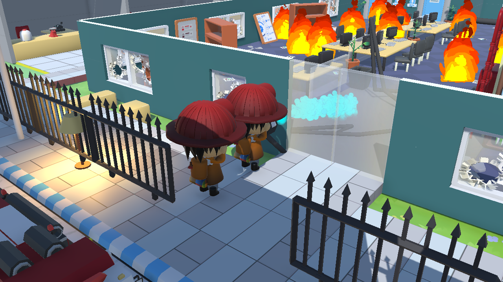

# Fire hose kooperatif — Gameloop_Demo

Implementasi menggunakan `HoseWaterController`, VFX WaterCanon, kabel fisika `PhysicCable`, dan `Fire.TryExtinguish` yang sudah ada. `FireSpawner.cs` serta konfigurasi FireSpawner di scene dipertahankan.

## Cara mencoba

1. Buka `Assets/Scenes/Gameloop_Demo.unity`, masuk Play Mode, fokuskan Game View.
2. Ambil nozzle depan dan pegangan bulat di belakang dengan dua karakter. Pickup memakai event kontak animasi yang sudah ada. Setiap pegangan hanya menerima satu pemain.
3. Pemegang depan menggerakkan formasi dan mengarahkan nozzle. Pemegang belakang menahan tombol tekanan. Air menyusut ketika tombol dilepas, lalu berhenti; tekanan tidak terkunci pada nilai terakhir.
4. Gunakan tahan–lepas untuk mempertahankan tekanan. Terus menahan sampai 125% akan melepas kedua pegangan dan mendorong pemain depan ke belakang/serong. Sesudah pemulihan singkat, pegangan bisa diambil kembali.
5. Pemegang belakang dapat memperpanjang/memperpendek selang dengan dua toggle. Tekan tombol yang sama untuk berhenti; tombol lawan mengganti arah. Pemendekan tidak boleh menarik nozzle melewati jarak yang sedang dibutuhkan pemain.

| Fungsi | Player 1 | Player 2 |
|---|---|---|
| Ambil/lepas pegangan | F | Right Ctrl |
| Bergerak; depan memimpin saat berdua | WASD | Arrow keys |
| Arah horizontal/vertikal; peran depan | J/L dan I/K | P / ] kiri-kanan, - / [ atas-bawah |
| Tahan tekanan; peran belakang | G | Enter |
| Toggle perpanjang/perpendek; peran belakang | R / T | N / M |
| Interaksi pintu/lampu saat tangan kosong | E | Right Shift |
| Lari ketika bebas | Left Shift | Right Alt |

Peran mengikuti pegangan yang diambil, bukan nomor pemain. P2 bisa berada di depan dan P1 di belakang. Melepas salah satu pegangan menghentikan air dan melepas tim. Disable komponen pemain/selang juga membersihkan kepemilikan.

## Nilai awal dan animasi

- Tekanan naik 20%/detik, turun 45%/detik; peringatan merah di atas 100%, recoil pada 125%.
- Selang mulai 6 m, batas konfigurasi 3–18 m, kecepatan reel 1,5 m/detik. Panjang diubah melalui jarak istirahat spring joint pada kabel yang sama, tanpa membuat ulang kabel.
- Diameter kabel aktif dan segmen pendukung 0,18 m, diperbesar dari konfigurasi 0,10 m.
- Arah horizontal 360°, elevasi ±65°. Gerak tim 1,6 m/detik, dibatasi panjang kabel dan collider lingkungan.
- `HoseHold` pada Hose Layer memakai take `metarig.009|Using_Fire_Hose` dari `FireHoseUse.fbx` (frame 60–61). Mask tubuh atas mengecualikan akar, pelvis, dan kaki, sehingga locomotion tetap berasal dari Base Layer. Carry/Hose Layer berganti dengan blend; IK tangan mengikuti grip dan lean badan mengikuti tekanan.
- Recoil menggunakan dorongan pada bidang XZ, sesuai controller top-down yang mengunci tinggi karakter; durasi pemulihan 0,85 detik.

## Integrasi scene

Karakter aktif berasal dari konfigurasi `AdaptiveAnimation_Demo`, termasuk rig tangan, lean, pickup/place-down, carry kooperatif, dan transisi jalan/lari. Karakter lama disimpan nonaktif sebagai `Legacy_Player1/2`. Target Group kamera mengikuti kedua karakter aktif. Kotak small/medium/big, heavy crate kooperatif, dan lampu interaktif ditempatkan di halaman untuk mencoba sistem sebelumnya. Pintu yang sudah ada tetap memakai dispatcher interaksi yang sama.

Sudut follow kamera di scene disesuaikan menjadi diagonal dari atas agar atap bangunan depan tidak menutup kedua pemain. Game View sesudah perubahan ini diperiksa dalam Play Mode; Console tidak mencatat error/warning. Editor dikembalikan ke Edit Mode pada `Gameloop_Demo`.

## Pengujian

`Assets/Tests/Editor/CooperativeHoseTests.cs` menguji scene tersimpan dalam Play Mode melalui Unity Test Framework: jalur pickup berbasis animation event, kontak IK, pembagian peran, anti-rebut, tekanan/VFX naik–turun, reel dan spring joint, penghalang semprotan, pemadaman Fire yang ada, recoil/pemulihan, pertukaran peran, dan cleanup.

Pengujian otomatis memanggil jalur interaksi dan menyuplai input tekanan/arah secara terkontrol. Kenyamanan tombol ketika dua orang memakai satu keyboard tetap perlu dinilai dalam playtest bersama, termasuk keterbatasan keyboard rollover.

Hasil sebelum perluasan props: **8/8 test lulus** pada assembly `AdaptiveCarry.Tests`, job Unity `1bb1abad5d8d497b82112619397f5559` (12 Oktober 2026). Termasuk regresi carry, kepemilikan/place-down/running, pintu/lampu, serta dua test hose. Kontak ujung tangan diperiksa pada elevasi ekstrem; mask pose juga diuji agar tidak mengangkat kaki. Tidak ada perubahan pada empat blok serialized FireSpawner di scene. Hash SHA-256 `FireSpawner.cs` tetap `F066DD0CB3675E362E0373312DB1D730A3469D50F0C39AE9F67F82E22B81464F`.

Setelah perluasan props dan perubahan tombol/diameter: regresi assembly **9/9 lulus** (job a05acfa6dc924eca905636ffbbba2e1e). Tes props akhir lulus (0f9f1f9f090446419e7f7bfed461103c), lalu kedua tes hose dijalankan kembali pada scene final dan **2/2 lulus** (5cd4418f9c7e4262bcdd714bc18877af).
