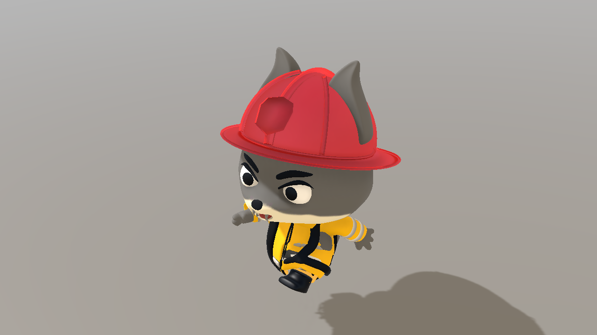

# Walking and Head Stability Verification — 2026-11-14

## Scope and changes

User feedback: free walking felt too slow, the loop felt discontinuous, and the moving head changed shape. Repair these issues while preserving existing mechanics. Verification used Gameloop_Demo in Unity 2022.3.62f2 through Unity MCP.

- Player.prefab now applies a 1.5 multiplier to unladen walking: the authored 1 m/s becomes 1.5 m/s. BaseMoveSpeed remains 1 m/s for carried loads. Pickup, placement, external interaction locks, cooperative carry and hose operation exclude the multiplier. Acceleration, deceleration, animation damping, dash settings and load curves remain unchanged.
- Walking playback still follows actual horizontal movement. Its unladen ceiling accommodates the increased speed; the loaded ceiling remains 1.3. Reference speed remains 1 m/s and the Walking state's speed remains 3.1.
- The active Walking state uses Running.anim. Its endpoint poses already matched, but its end/start velocities did not. Matched endpoint tangents on 63 curves, preserving key times, values and interior keys. Unity's native save also serialized expanded editor-curve data, accounting for the large textual asset diff. No animator state or transition changed.
- The replacement head had mixed head/neck/shoulder skin weights under a nonuniformly scaled armature. Its physical dimensions varied roughly 6–7% over sampled gait phases. Nine saved head, face, ear and helmet meshes now follow a common, uniformly scaled RigidHead transform. CharacterRigidHeadFollower copies only the mirrored head's world position and rotation after the mirror's LateUpdate. Body bones, body animation, IK and the imported FBX remain unchanged.
- Firefighter_RigidHead.asset stores the persistent reference-pose meshes, retaining renderer names, materials and submeshes. Bindposes and root-bone-space culling bounds were fitted using Unity's baked geometry. Runtime movement performs no vertex reads or mesh rebuilding.

## Final focused verification

Twelve distinct methods passed across final focused runs: four walking/head checks and eight related regressions. This is not a full-project-suite result. The seam check is an Editor asset test; the other eleven enter Play Mode.

| Check | Result |
| --- | --- |
| ActiveWalkingClipHasContinuousPoseAndVelocityAtItsSeam | Passed. Endpoint pose delta 0; finite-difference position derivative mismatch 0.0000615 m/s and quaternion component derivative mismatch 0.0403 at a 0.0005 s sample interval. |
| BothPlayersWalkFasterWithMatchedCadenceAndStopCleanly | Passed. P1 measured 1.508 m/s with rate 1.500; P2 measured 1.498 m/s with rate 1.500. Independent input, stop-to-idle and restart checked. |
| FreeWalkIncreaseDoesNotChangeLoadedComputerSpeed | Passed. A 30 kg computer retained the existing expected 0.65 m/s; measured 0.639 m/s. Free movement recovered to 1.5 m/s after release. |
| HeadAndFaceRemainRigidThroughFullWalkCyclesAndTurning | Passed for both players across 40 walking/turning samples each. Nine original skins and nine outline clones followed the saved rigid root. Maximum sampled shape drift: P1 0.00000872 m, P2 0.00000850 m. Facial centroids, persistent meshes, head pose and world-space culling bounds also checked. |
| AdaptiveCarryTests.FootPlantCadenceMatchesDemoMovement | Passed. |
| AdaptiveInteractionContextTests.ObjectInteractionContextTracksReservationAndClearsOnCompletionOrDisable | Passed. |
| CylinderGripTests.SavedCylinderPickupContactsScaleAndWeightForBothPlayers | Passed. |
| GameloopCarryMotionTests.HeavySoloAndTeamGaitMatchDisplacement | Passed. Heavy solo motion 0.0499 m/s / playback 0.0480; team turn motion 0.647 m/s / playback 0.647. |
| GameloopMigrationTests.DestinationHoseMaintainsVisibleContactsAndClearance | Passed. |
| GameloopMigrationTests.DestinationHosePressureReelAndExtinguishing | Passed. |
| GameloopMigrationTests.DestinationPropsPickupVisibleContactsAndBodyLean | Passed. Computer/table hand-to-surface distances below 0.0004 m; controlled heavy-computer chest lean remained about 24 degrees. |
| GameloopMigrationTests.SpawnedPlayersKeepModelsMoveIndependentlyAndDash | Passed. Independent input and saved visible helmets checked; dash distance remained about 1.905 m for each player. |

Jobs: `95fe297707c641deb554ac6c7b7e0a31` supplied the first two new passes; `5cd32cf6d05f4cb4aa4591e5f2a9ba53` passed the corrected remaining two checks; `af7a9f95abb34910a28c91e0ec1d79bc` passed all eight regressions. The initial new-test run exposed two fixture issues: a released computer obstructed the recovery measurement, and the outline system legitimately duplicated head renderers. The fixture now moves the released prop aside and tests outline geometry while checking the nine original renderer names separately. Product assertions were retained.

The head test removes only world translation and quaternion rotation. Inverting the full head transform would remove scale/shear and could conceal the reported defect. BakeMesh(useScale: true) was verified against this imported rig's renderer transforms.

Final Console inspection found zero errors and zero warnings. Visual inspection included free walking and fresh computer-carry/Cylinder captures. Editor was returned to Gameloop_Demo outside Play Mode with no unsaved scene changes. Temporary staging floors and cameras were not saved into the scene.

## Preserved assets

These SHA-256 hashes match task-start snapshots. This task did not alter these assets; the working tree already contained earlier work.

| Asset | SHA-256 |
| --- | --- |
| Gameloop_Demo.unity | F4B449596ED6DA7D2BEE78CDF97E900D31188695529C317DB80233EBB709BEAF |
| AdaptiveAnimation_Demo.unity | 033E02C533E3A76DB2689DF359C3C13517C10F0C2F0ED01110C6BCD6A67295FF |
| MainMenu.unity | DBBABFF57837C27BE02FDB33CC1E9E50E21E219E589F1FF3AD63C764A457DD9C |
| Shared_CarryWeightSpeed.asset | DB2C13C60EED254F5B3462B3461B514A849FE4C63EE318C556AE92A757898612 |
| Controls.inputactions | C839A279ACEF264AA7AF616AF0AAE398AD51848E592D5DDDF13F47766458E63A |
| Dash.anim | DFCAFE10AC78B584AA49ECEADA6CED9BD0112A7111D6EB9D0D4393B38B6E3CCB |
| Mulyono.controller | C5A2C360FC443FB55111E6A8F43EB7D481FABF4648AEBCAAE49832A5FB3F343F |
| CharacterModelAnimatorMirror.cs | E7861495CA1AD8400319DCA57D7286CA042E6CE6D2FC3536869557AC969A6D5D |

## Limits and maintenance

These are Editor Play Mode results, not standalone-build validation or a subjective naturalness study. The head follows its pose rigidly; these source meshes have no facial blendshapes. At the time of this verification, Apply Model did not reproduce the rigid-head setup. The 15 November follow-up now preserves its authored bindings across same-model Apply, Restore and prefab reload; see [model replacement workflow](Character-Model-Replacement.md). Changing the source model/dependencies or headgear calibration still requires rebuilt calibrated meshes.
